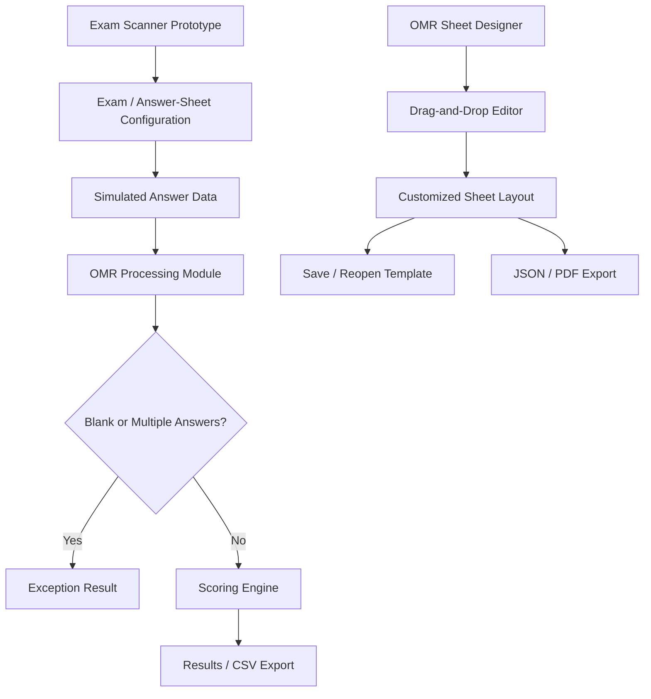

<div align="center">

# 📝 Exam Scanner & OMR Sheet Designer

### Web-Based Exam Management and Answer-Sheet Customization Prototype

**Next.js • React • JavaScript • Konva • jsPDF**

A two-part prototype for creating customizable OMR answer sheets and exploring exam management, simulated scanning, exception handling, and configurable scoring workflows.

</div>

---

## 🎯 Project Overview

**Exam Scanner & OMR Sheet Designer** brings together two independent web applications in one repository:

1. **Exam Scanner Prototype** — an exam and answer-sheet management interface with a simulated OMR processing pipeline, result handling, and configurable scoring rules.
2. **OMR Sheet Designer** — a drag-and-drop editor for composing custom answer sheets using text, shapes, images, and OMR answer rows, with template saving and export options.

> **Prototype scope:** The scanner currently evaluates simulated answer data (`mockAnswers`) rather than extracting filled bubbles from real scanned images. The project demonstrates workflows and interface concepts; it is **not** a production-ready optical recognition system.

---

## ✨ Key Features

### 📋 Exam Scanner Prototype

- **Exam and answer-sheet configuration:** Interface for managing exam-related templates and details.
- **Simulated OMR processing:** Passes predefined answer data through an OMR processing module.
- **Exception detection:** Flags blank responses and questions with multiple recorded answers.
- **Configurable scoring:** Compares responses with an answer key, with support for question-specific accepted-answer rules.
- **Result reporting:** Displays processed results and supports CSV export of scan results.
- **Template composition interface:** UI controls for configuring answer-sheet elements and previewing templates.

### 🎨 OMR Sheet Designer

- **Drag-and-drop canvas:** Position and arrange answer-sheet elements visually with React Konva.
- **Custom elements:** Supports circles, rectangles, lines, text, text boxes, images, and OMR answer rows.
- **Property editing:** Adjust supported element attributes in the editor.
- **Template management:** Create, reopen, and delete saved templates in the browser.
- **JSON import/export:** Exchange editable layout data.
- **PDF export:** Generate a printable document from a designed sheet.

---

## 🛠️ Technology Stack

| Category | Technologies |
| --- | --- |
| Frontend | React, JavaScript, Next.js |
| Styling | CSS; Tailwind CSS (exam scanner) |
| Interactive canvas | React Konva, Konva |
| Drag and drop | React DnD (exam scanner dependency), canvas editing (sheet designer) |
| PDF generation | jsPDF |
| Icons | Lucide React (exam scanner) |
| Template persistence | Browser `localStorage` (sheet designer) |
| Package management | npm |

The two apps use separate Next.js and React versions, so they should be installed and run **independently**.

---

## 🏗️ System Components & Workflow



**Note:** These are two applications maintained in the same repository. The diagram shows their individual workflows, not an implemented automatic connection between them.

### Scanner Processing Logic

1. A simulated card provides an `image.mockAnswers` array.
2. `omrEngine.js` checks for blank and multiple-answer exceptions.
3. When no exception is found, `scanEngine.js` passes answers to `scoringEngine.js`.
4. The scoring engine compares answers against the selected answer key and any applicable accepted-answer overrides.
5. The interface can display and export result data.

---

## 📁 Repository Structure

```text
Exam-Scanner-OMR-System/
├── exam-scanner/
│   ├── app/
│   │   ├── services/
│   │   │   ├── omrEngine.js
│   │   │   ├── scanEngine.js
│   │   │   └── scoringEngine.js
│   │   ├── globals.css
│   │   ├── layout.tsx
│   │   └── page.js
│   ├── public/
│   ├── package.json
│   ├── package-lock.json
│   └── README.md
│
├── exam-sheet-designer/
│   ├── components/
│   │   ├── CanvasStage.js
│   │   ├── EditorSidebar.js
│   │   └── ShapeToolbar.js
│   ├── pages/
│   │   ├── _app.js
│   │   ├── designer.js
│   │   ├── index.js
│   │   └── savedTemplate.js
│   ├── public/
│   ├── styles/
│   ├── package.json
│   ├── package-lock.json
│   └── README.md
│
└── README.md
```

Each subproject also contains its own configuration files. Some hidden files such as `.gitignore` may not be displayed in GitHub's file list unless you open the folder.

---

## 🚀 Installation & Setup

### Prerequisites

- Node.js and npm compatible with the installed Next.js versions (the scanner uses Next.js 16; the designer uses Next.js 14).
- A modern web browser.

### 1. Clone the repository

```bash
git clone https://github.com/chongwinnie/Exam-Scanner-OMR-System.git
cd Exam-Scanner-OMR-System
```

### 2. Start the Exam Scanner Prototype

```bash
cd exam-scanner
npm install
npm run dev
```

Open **http://localhost:3000**.

### 3. Start the OMR Sheet Designer

Open a **new terminal** in the repository's root directory:

```bash
cd exam-sheet-designer
npm install
npm run dev -- -p 3001
```

Open **http://localhost:3001**.

> Both applications normally default to port 3000. Using port 3001 for the designer lets you run them simultaneously.

---

## 🧭 How to Explore the Prototype

### Exam Scanner

1. Open the scanner application.
2. Explore the exam/template management screens.
3. Review the simulated scanning workflow and exception states.
4. Inspect scoring and result-handling views; export available results to CSV.

### OMR Sheet Designer

1. Open the designer application and select **Open Designer**.
2. Create a new template from the saved-templates page.
3. Drag elements onto the canvas and edit their properties.
4. Save the template to the browser or export it in an available format.
5. Reopen saved templates to continue editing.

---

## ⚠️ Prototype Scope & Limitations

- **No real optical recognition yet:** `omrEngine.js` reads `mockAnswers`; it does not analyze uploaded photographs or live scanner images for marked bubbles.
- **Not a deployed back-end system:** The shared repository does not establish a production database or hosted scanning service.
- **Browser-local designer templates:** The sheet designer stores templates with `localStorage`, so templates are tied to a particular browser/profile unless exported.
- **Separate applications:** The scanner and sheet designer have independent project folders and are not automatically synchronized.
- **Not validated for production grading:** Scoring and document-export behavior should be tested further before use in real examination workflows.

---

## 🔮 Possible Future Improvements

- Integrate image capture or scanned-sheet upload and genuine optical mark recognition.
- Connect sheet templates directly to the scanner's answer-sheet definitions.
- Add persistent backend storage for exams, candidates, templates, and results.
- Introduce automated tests for scoring, exceptions, exports, and interface workflows.
- Add scanning calibration and confidence indicators for ambiguous marks.

These are **potential enhancements**, not currently implemented features.

---

<div align="center">

**Made to explore smarter exam workflows, one bubble at a time. 🫧**

</div>
